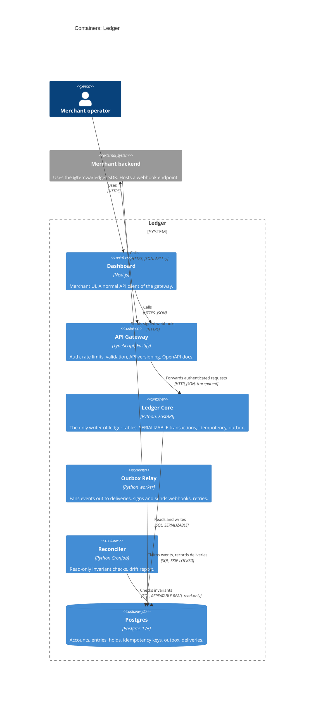

# C4 Level 2: Containers

The deployable pieces inside Ledger and how they talk.

## Notes

| Container | Scales by | State |
|---|---|---|
| Gateway | Horizontal, stateless | Rate-limit counters (in-memory per instance in v1) |
| Core | Horizontal, stateless | None; all state in Postgres |
| Relay | Horizontal; `SKIP LOCKED` lets replicas share work | None |
| Reconciler | One run at a time (advisory lock) | Writes `reconciliation_runs` only |
| Postgres | Vertical (single primary in v1) | Source of truth |

Component-level detail for the core (C4 Level 3) is added in Week 2, once the module boundaries exist in code.
