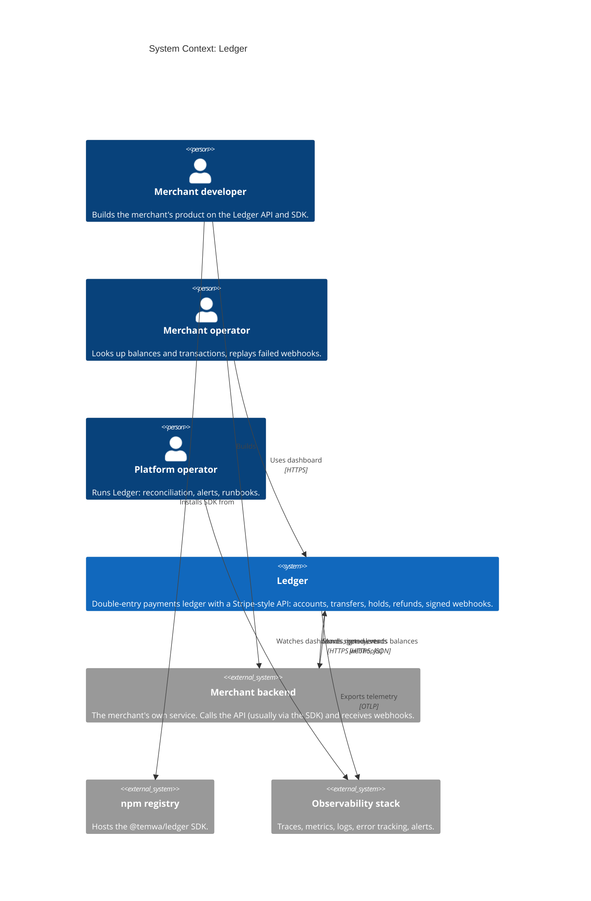

# C4 Level 1: System Context

Who uses Ledger, and what it talks to.

## Notes

- The webhook consumer is part of the merchant backend. It is the thing that must dedupe events by `id` ([ADR-0007](../adr/0007-exactly-once-effects.md)).
- No real money enters or leaves. The `external` system account stands in for the outside world.
