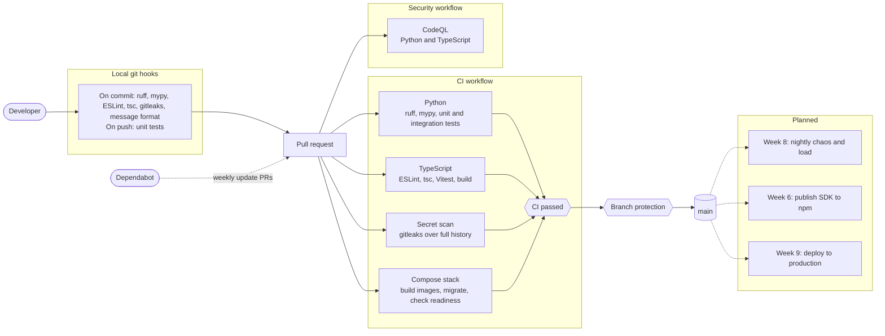

# CI/CD Pipeline

Every pull request and every push to `main` runs the same checks. Local hooks catch problems early, but they can be skipped, so CI is what enforces the rules.

## Decisions

| Decision | Why |
|---|---|
| Branch protection requires one check, `CI passed` | Jobs can be added or renamed without editing the rule. A skipped or cancelled job counts as a failure. |
| Integration tests run on every PR | Correctness depends on real Postgres behaviour, so a mock wouldn't prove anything. |
| The compose stack is started in CI | It catches broken Dockerfiles, migrations and role grants that unit tests can't see. |
| Actions are pinned to full commit SHAs | A moved tag can't change what runs. Dependabot keeps the pins current. |
| `GITHUB_TOKEN` is read-only by default | Only the CodeQL job gets more: `security-events: write`, to upload results. |
| Dependabot waits 7 days before proposing Python and npm releases | It gives the ecosystem time to catch a compromised release before it reaches this repo. |
