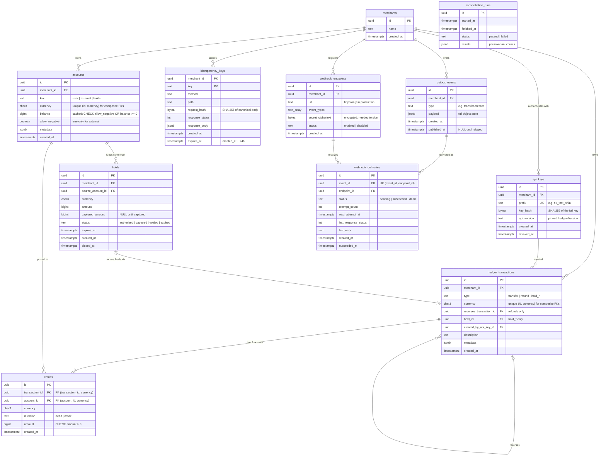

# Entity-Relationship Diagram

The v1 schema. Column types are Postgres types; `char3` means `char(3)`.

## Constraints the diagram can't show

| Rule | How it's enforced |
|---|---|
| Debits = credits per transaction, ≥ 2 entries (INV-1) | Deferred constraint trigger on `entries` ([ADR-0003](../adr/0003-zero-sum-enforced-in-database.md)) |
| Entry currency = account currency = transaction currency | Composite FKs `(account_id, currency)` and `(transaction_id, currency)` |
| No overdraft on user and holds accounts (INV-4) | `CHECK (allow_negative OR balance >= 0)` on `accounts` |
| Entries and transactions never change (INV-5) | No UPDATE/DELETE grants, plus a rejecting trigger ([ADR-0002](../adr/0002-immutable-entries.md)) |
| One system account of each kind per merchant and currency | Partial unique index on `accounts (merchant_id, kind, currency) WHERE kind <> 'user'` |
| One delivery per event per endpoint | Unique `(event_id, endpoint_id)` on `webhook_deliveries` |

## Indexes worth noting

- `entries (account_id, created_at DESC)` for account statements.
- `outbox_events (created_at) WHERE published_at IS NULL` so the relay's claim query stays fast as the table grows.
- `webhook_deliveries (next_attempt_at) WHERE status = 'pending'` for the dispatcher.
- `holds (expires_at) WHERE status = 'authorized'` for the expiry job.
- `idempotency_keys (expires_at)` for cleanup.
