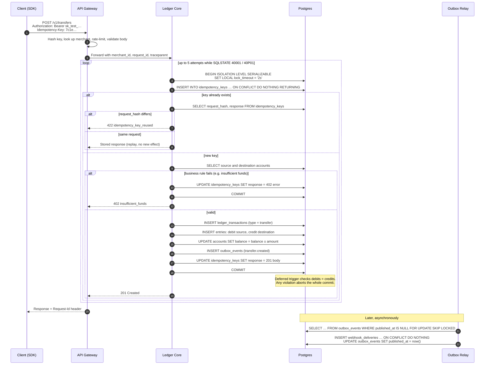

# Sequence: Create a Transfer

The happy path, an idempotent replay, and the serialization-retry loop, all in one picture.

## Reading notes

- **Steps inside the loop are one database transaction.** The money movement, the outbox event and the stored response commit together or not at all.
- **Concurrent same-key requests:** the second `INSERT … ON CONFLICT` waits on the first's uncommitted row. When the first commits, Postgres aborts the second with `40001`; the loop re-runs it and it takes the "key already exists" branch.
- **Retries exhausted:** the core returns 503 `ledger_contention` (not shown). The client retries with the same key.
- Webhook dispatch from `webhook_deliveries` is covered in a separate sequence diagram (Week 4).
