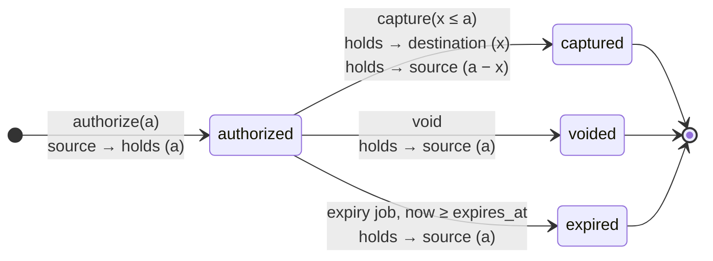

# State Machine: Hold

See [ADR-0008](../adr/0008-holds-as-state-machine.md) for the reasoning.

## Rules

| Rule | Enforcement |
|---|---|
| Only `authorized` can transition | `UPDATE holds SET status = :to WHERE id = :id AND status = 'authorized'`; 0 rows → 409 `hold_not_authorized` |
| Capture amount is `1 ≤ x ≤ a` | Validated before any write |
| Terminal states never change | No transitions out of `captured`, `voided`, `expired` in the transition table |
| Funds are always conserved | `captured_amount + released = amount` once closed (INV-8), checked by the reconciler |
| `holds` account balance = sum of open holds | Checked by the reconciler |

## Races and who wins

| Race | Result |
|---|---|
| capture vs. void | Whichever commits first; the other gets 409 with the current status. |
| capture vs. expiry job | Same. A capture that arrives after `expires_at` but before the job runs is rejected (`hold_expired`). |
| two captures | One succeeds; the other gets 409. |
