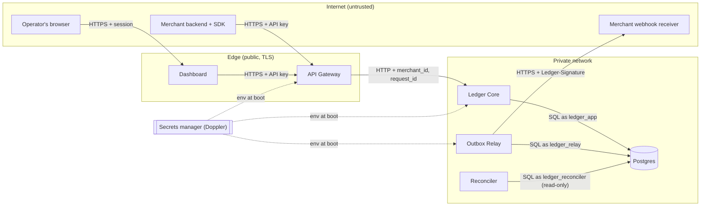

# Threat Model

| | |
|---|---|
| **Method** | STRIDE per element, over the data-flow diagram below |
| **Last reviewed** | 2026-10-11 |
| **Scope** | Ledger v1 as described in the [design doc](design-doc.md), including the public sandbox demo |

## Assets

| Asset | Why it matters |
|---|---|
| Ledger integrity (entries, balances) | The whole point of the system. Tampering = creating or destroying money. |
| API keys | Full access to a merchant's ledger. |
| Webhook signing secrets | Let an attacker forge events that merchants will trust. |
| Tenant isolation | One merchant must never see or move another's money. |
| Availability | A ledger that is down blocks every payment. |

## Data flow and trust boundaries

**Trust boundaries:** Internet → Edge (TLS, API-key auth, rate limits), Edge → Private (only the gateway can reach the core), Private → Internet (outbound webhooks, the SSRF surface).

## STRIDE analysis

| # | Threat | Element | Mitigation | Status |
|---|---|---|---|---|
| **Spoofing** | | | | |
| S1 | Stolen or guessed API key used to call the API | Gateway | 32 bytes of random entropy per key; stored as SHA-256 hash; constant-time compare; revocation; keys never logged (redaction) | Planned W5 |
| S2 | Caller bypasses the gateway and calls the core directly with a forged `merchant_id` | Core | Core is not publicly routable; gateway → core requests carry a shared internal token; core rejects requests without it | Planned W5 |
| S3 | Attacker forges webhooks to a merchant | Receiver | HMAC-SHA256 signature over `timestamp.body` with a per-endpoint secret; SDK verifies in constant time | Planned W4 |
| **Tampering** | | | | |
| T1 | Ledger history edited to hide or create money | Postgres | Append-only entries enforced by grants and trigger (ADR-0002); reconciler recomputes balances from entries | Planned W2 |
| T2 | Unbalanced or cross-currency transaction written by a bug | Postgres | Deferred zero-sum trigger and composite FKs (ADR-0003) | Planned W2 |
| T3 | Same request replayed to move money twice | Core | Required idempotency keys stored atomically with the effect (ADR-0005) | Planned W3 |
| T4 | Captured webhook replayed later to a merchant | Receiver | Timestamp in signature, 5-minute tolerance, event-ID dedupe (ADR-0007) | Planned W4 |
| T5 | Request body tampered in transit | All | TLS everywhere on public links; HSTS on `*.temwa.dev` | Planned W9 |
| **Repudiation** | | | | |
| R1 | Merchant denies having made a transfer | Core | `created_by_api_key_id` on every transaction; request ID on every log line and response; immutable history | Planned W2 |
| **Information disclosure** | | | | |
| I1 | Merchant A reads merchant B's data (IDOR) | Core | Every query filtered by authenticated `merchant_id`; cross-tenant IDs return 404, not 403; integration tests try it explicitly; Postgres RLS as a second layer | Planned W2, RLS W9 |
| I2 | Secrets leak via logs, errors or the repo | All | Structured-log redaction; generic 500 bodies; gitleaks in CI; secrets only in Doppler | Planned W1 |
| I3 | Webhook secrets read from a database dump | Postgres | Secrets encrypted at the application layer with a key held only in the secrets manager | Planned W4 |
| I4 | SSRF: merchant registers a webhook URL pointing at internal services (e.g. `169.254.169.254`, `10.0.0.0/8`) | Relay | HTTPS-only in production; resolve DNS and reject private, loopback and link-local ranges at registration **and** at send time (DNS rebinding); no redirects followed; response bodies capped and never shown verbatim | Planned W4 |
| **Denial of service** | | | | |
| D1 | API flooded by one key | Gateway | Per-key token-bucket rate limit; request body size limit (64 KB) | Planned W5 |
| D2 | Expensive queries exhaust the database | Core | Pagination capped at 100; `statement_timeout`; bounded connection pool | Planned W2 |
| D3 | Slow or hanging webhook receivers tie up the relay | Relay | 10 s timeout; bounded concurrency per endpoint; failing endpoints auto-disabled after 3 days | Planned W4 |
| D4 | Public sandbox abused | Gateway | Strict sandbox rate limits; nightly data reset; no real money | Planned W9 |
| **Elevation of privilege** | | | | |
| E1 | Compromised core process alters schema or history | Postgres | Least-privilege roles: `ledger_app` has no DDL and no UPDATE/DELETE on entries; migrations run as a separate role | Planned W1 |
| E2 | Malicious dependency (supply chain) | Build | Lockfiles; Dependabot; CodeQL; npm publish with provenance and 2FA; SBOM in CI | Planned W1, W6 |

## Out of scope

- Physical and cloud-provider account security (handled by the provider and account 2FA).
- Fraud and money-laundering patterns (the PRD excludes real money).
- Side-channel attacks on the hosting platform.

## Review triggers

Re-run this analysis when any of these change: a new public endpoint, a new external integration, a new data store, or a change to authentication.
